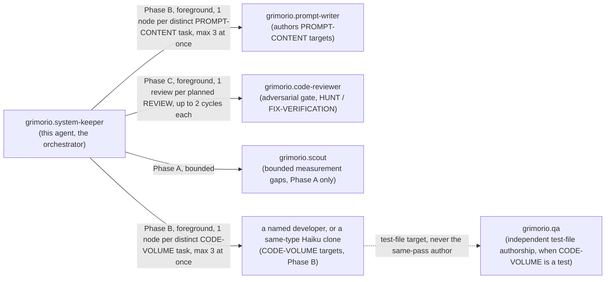
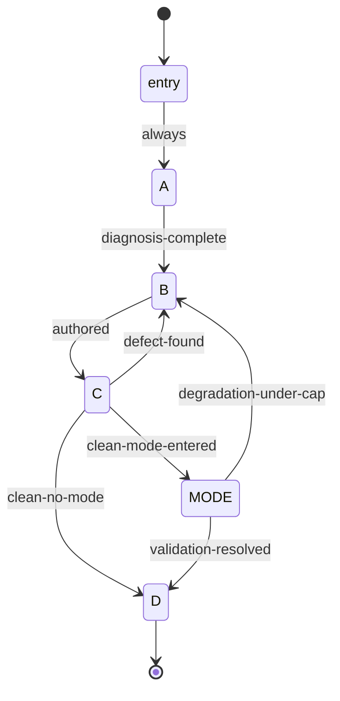

# System Keeper — quasi-software design view

The saved, drawn reference for `grimorio.system-keeper`'s own phase chain, per
ref:skill/grimorio.phase-splitting#the-drawn-view. Rewritten
in full for the 2026-09-16 rewrite — the prior 882-line version described a 7-phase, tmp/-fingerprinted chain
that no longer exists; this file describes the 4-phase, script-driven chain that replaced it. Kept
deliberately short: the phase files themselves are the authority on WHAT each phase does; this file is only
the drawn SHAPE, per the ~500-line smell threshold (ref:skill/grimorio.conduct#branches-commits-and-knowledge
rule 23).

## Why the rewrite — the measurement that forced it

Three passes of the prior 7-phase chain measured 1,600,000 / 481,000 / 619,679 child tokens; two passes wrote
205KB of tmp/ prose no downstream phase ever read. The chain's own line count was 3,058 across the 7 phase
files, the improve-and-validate-mode file, and this view — loaded piecemeal, but each phase still paid a
disk-write-and-regex-check tax (`fingerprint-gate.md`) on every single hand-off. The rewrite: fewer, merged
phases (7 → 4 + 1 conditional mode), and the disk-write/regex-check hand-off replaced by a mechanical script
that resolves the next phase's location from a fixed table, per the CEO's own instruction that the location of
the next phase "puede estar escondida a través del script... y que se pueda invocar incluso para que se pueda
saltar directamente y que sea completamente mecánico."

## Layer 1 — NODES: the orchestration graph

## Layer 2 — PHASES: the state machine, script-driven

Every edge below is a real transition in the `next` map, per phase, of
ref:agent/grimorio.system-keeper/phases/chain.json — this view and that manifest must never drift out of sync; a
change to one is a change to both, in the same pass. The same holds for what a phase produces: the manifest lists
Phase B's `deliverable` and the `BATCHES + REVIEW` fingerprint the engine checks before B leaves, and Layer 3 states
both.

| Node | File | Question it answers |
|---|---|---|
| entry | `behavior.md` | Phase 0 — carry the caller's inputs forward, call the phase server |
| A | `phase-a-intake-diagnosis.md` | What was asked, what is actually true, and is it SYSTEMIC? |
| B | `phase-b-placement-authoring.md` | Where does it go, and who actually writes it? |
| C | `phase-c-verification-review.md` | Does it hold under the keeper's own eyes, then an independent adversary's? |
| MODE | `system-keeper-improve-and-validate-mode.md` | (conditional) Does the improvement TRANSMIT to a blind successor? |
| D | `phase-d-close-out.md` | Is the record durable, and what does the caller need told? (terminal) |

**A `jump` command exists in the script for a genuinely mechanical skip straight to any node** — e.g. a
caller brief that already hands a fully-specified plan may jump straight to B — logged with a required reason,
never a silent shortcut.

## Layer 3 — INTERNAL artifact flow, per phase

| Phase | Consumes | Produces (carried in reasoning into the next phase, unless the row says it is recorded) |
|---|---|---|
| A | caller's brief, `GRIMORIO-CHAIN.md`, target files | objective/exit condition, verbatim content held, LIGHTWEIGHT/FULL-CEREMONY, refuted-or-adopted verdicts, true cause, SYSTEMIC-vs-SPECIFIC + propagation targets, MODE ENTERED y/n |
| B | everything A produced | the node plan (one node per distinct task, small pieces riding along), target file(s) + level, delegation decisions (writer / developer / Haiku clone), what the writer/delegate actually returned; RECORDED: a `deliverable` written to `tmp/<agent-id>/` as plain `BATCHES:` and `REVIEW:` lines, which the engine's fingerprint gate requires before B leaves |
| C | everything B produced, including its `REVIEW:` plan | pointer-check results, the five writer-output properties, selftest results, each planned review's verdict history |
| MODE (conditional) | Phase C's clean disposition | the successor's cold-graded output, the firing-log query, the byte-diff check, PASS/DEGRADATION |
| D | everything upstream, restated | the final report — `## OUTPUT` block, this file's only durable prose artifact |

Phase B's recorded `deliverable` (BATCHES and REVIEW), Phase D's `## OUTPUT` block, the worktree's own commits, and
(when MODE fires) the `tmp/<slug>/PLAN-GRAPH.md` three-plans artifact are the only things written to disk
mid-chain — no other phase dumps a deliverable.

## Layer 4 — PARALLELIZATION

Phase B is the only phase that can fan out, and it fans out in proportion: one `grimorio.prompt-writer`/CODE-VOLUME
node per distinct task its Independence Test confirmed, at most three at once with the rest in the next round. A
piece of a line or two is no task: it rides with the task it belongs to, or with a node already going. INTERCONNECTED
pairs run SEQUENTIALLY; INDEPENDENT pairs run as a FOREGROUND PANEL (`run_in_background: false`, one message, capped at
2-3 concurrent) — never backgrounded, either shape, absolute.

Reviews are proportional too. Phase B's `REVIEW:` plans one review per task when the tasks are big and merge
separately, one over everything when the pieces are small or merge together, never one per small piece or per chunk.
Phase C runs one reviewer instance at a time per planned review, up to 2 cumulative cycles each, handing it only the
diff and the principal's words. Phase A's optional `grimorio.scout` raise is always a single bounded node.

## Layer 5 — EXPECTED OUTPUTS

- Ordinary dispatch: Phase D's `## OUTPUT` block, closing VERIFIED (naming evidence per claim) or COULD NOT
  (naming the blocker).
- MODE dispatch: the same, plus MODE OUTCOME (PASS / ESCALATED) as an additional field.
- Either way: a merged branch (APPROVED or shipped-with-recorded-REWORK under the cap) or an unmerged one, left
  open and reported loudly (ESCALATE).

## Known errors this design closes — carried forward, never silently dropped

- **tmp/ prose nobody reads** (205KB measured across two passes) — closed by the phase-engine hand-off; the only
  deliverable a phase writes to disk is Phase B's two-field `deliverable`, and the engine's gate reads it.
- **Over-splitting and over-reviewing** (a node for a one-line change, a review per chunk) — closed by Phase B's
  proportionality rule; the BATCHES + REVIEW gate forces the plan to be written down before B leaves.
- **Exemplar-grounding skipping the HARNESS taxonomy** — Phase A step 3 now names the exact section to check
  before naming a fix's shape.
- **A prior keeper concluding a capability "cannot" exist without checking `GRIMORIO-INDEX.md`/`.claude/hooks/`
  first** — Phase A step 2 now forces that check before any absence conclusion stands.
