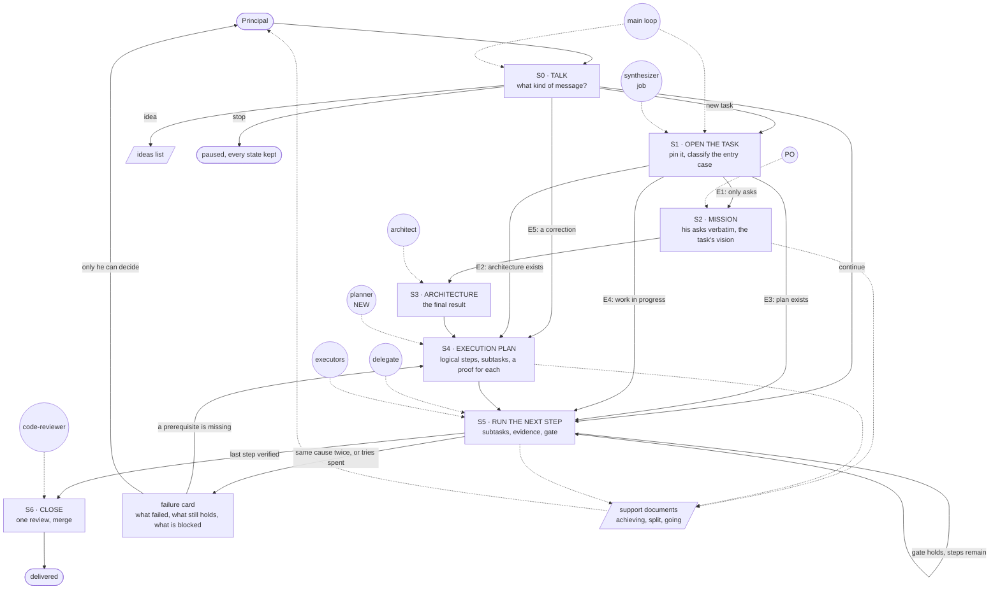
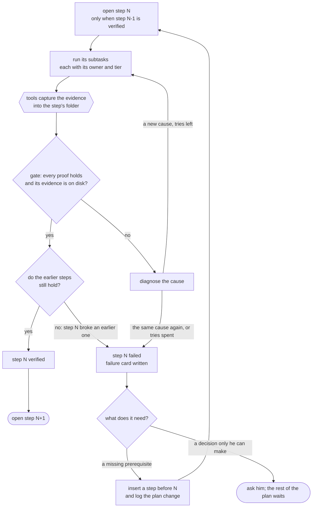

# Task flow — quasi-software view

How a task travels from the principal's "execute" to a delivered, proven result: the states it passes through
(STATE MACHINE), where it repeats (LOOP), and who acts on each state (GRAPH). The judgment it answers to is
ref:repo/.grimorio/design/task-flow/vision.md; the asks it answers are in
ref:repo/.grimorio/design/task-flow/pseudo-spec.md. A design document, never read at runtime.

**Marks used below:** **NEW** means it does not exist today. **OPEN** points to a decision in
ref:repo/.grimorio/design/task-flow/README.md. Anything unmarked describes what this design proposes, built from his
words.

## The flow in one diagram

Rectangles are states and circles are agents. Solid edges move the task; dotted edges show who works a state, and
what feeds the support documents.



**The two loops.** The S5 self-edge runs the plan one step at a time; it exits when the last step is verified, or
into a failure card. The failure card's edge back to S4 inserts the missing step and resumes; it never restarts the
plan.

## 1. The levels, and what each one leaves behind

His order: mission first, then the final result, then how to get there (A1). The architecture is context: it says
where to arrive. The execution plan is a different language: it says how to get there from what exists today (A4).

| Level | What it leaves | Written by | Today |
|---|---|---|---|
| Mission | his asks verbatim, numbered by message, plus the task's vision in the six fields of the vision format | the main loop; the PO when the ask is vague | the synthesizer overwrites its output every run; the PO brief exists for vague asks |
| Architecture | the final result | an architect (solution, web or game), or he and the main loop in conversation | exists: `arch-decision.md` and design documents |
| Execution plan | logical steps from today's state to the architecture; each step has a gate | **the planner, NEW** | nothing: no agent writes it (A5) |
| Subtasks | per step: what, owner, tier, output, proof type, state, the asks it covers | drafted by the planner, refined by the step's owner when the step opens | developers split by file, one child per file |
| Evidence | what tools captured per subtask, saved to disk | tools, during execution | partial: the manual verifier takes screenshots; nothing files them by step |
| Support documents | the three views of §6 | a render script, from all of the above | nothing: the agents' summary reaches him |

A task that needs no design states its target in one line inside the mission, and that line is its architecture.

**The task folder** holds the levels, one task per folder. Its location is OPEN (D3); it is not a branch (I1).

```
<task>/
  mission.md     his asks verbatim by message, and the task's vision
  architecture   the decision, or a pointer to it
  plan           steps and subtasks, their states, and the log of every plan change
  ideas.md       what was said and is not executed now
  steps/<id>/    the evidence captured for each subtask
  report.html    rendered from everything above
```

A subtask moves `pending → running → done-unverified → verified`, or to `failed` with its finding. Resuming reads
these states.

## 2. S0 and S1: what kind of message, and opening a task

Not every message is a new task (J3), and only a new task runs the whole flow (J6). **The kind is read from the
delta:** the messages of his since the last synthesizer run, which the script already computes (J7). The delta
cannot tell whether the whole task is complete. It does tell what his last messages were about: a correction, the
planning of something new, a plain go-ahead (J8). The kind then decides what travels to the agent: the task folder
alone, the delta, or the full accumulated record (J9).

| Kind | Sounds like | What travels to the agent | What runs | What does not run |
|---|---|---|---|---|
| idea | something for later | nothing, no spawn | "I'm saving this", and it goes to the ideas list (B1) | |
| new task | "execute", or a yes to the main loop's proposal | the full accumulated record | S1: every ask in the record goes to this task's mission, to ideas, or is marked already done; the plan is pinned; the coverage check reads the full record (B2, C1) | nothing skipped |
| continue | "continúa", "sí, sigue", "dale" (J3) | the task folder only | the open task resumes at its next step | consolidation, coverage check, board (J4, J10) |
| correction | "veo que está haciendo algo mal, lo reencamino" (J5) | the task folder plus the delta verbatim | E5: the ask is amended and the steps that cover it reopen; the coverage check reads only the delta | a new plan |
| stop | "para" | nothing, no spawn | the task pauses with every state kept | |
| question | "¿qué falta?" | nothing, no spawn | answered from the task folder | |

While a task is open, the conversation can move on and the plan waits (B3).

**Who names the kind.** The synthesizer names it on its delta run, and writes it into its output with the asks the
delta touches (§7). The hand-over carries that kind (J1): the main loop attaches what the kind needs, and the spawn
gate checks against the kind the synthesizer wrote. Because the kind comes from his words, the caller cannot label a
new task a "continue" to skip the checks.

**Why it matters today.** After every new message of his, the next grimorio spawn requires a full synthesizer run,
which also starts the board feeder, plus a coverage scout. A plain "continúa" pays all of that (J4). Narrowing it
changes the spawn gate, which is a hook: README D7.

**What the delta does not answer.** Whether the whole task is still covered is checked when the task opens, by the
consolidation, and by the plan checker (§9), never by the per-message step (J8).

## 3. Entry cases

The main loop names the case when the task opens, and writes it in the mission.

| Case | How it is recognised | What happens |
|---|---|---|
| **E1 only asks** | no architecture, no plan | the mission is written, an architect designs the target, the planner writes the plan (A2) |
| **E2 architecture exists** | an `arch-decision.md`, a design, or one agreed in conversation | the planner writes the plan **from** it and never redesigns it (D1, D3) |
| **E3 plan exists** | his own plan, or one made earlier | it is adopted as written. The planner only checks that every ask is covered, and adds steps for any ask that is not (D2) |
| **E4 work in progress** | a task folder with steps that are not verified | the `done-unverified` steps are re-checked; work continues at the first unverified step (D4, F4) |
| **E5 correction** | his message changes an ask | the ask is amended, the steps that cover it reopen, and every other step keeps its state (F5) |

## 4. S5: running one step

One step at a time. A review agent never runs inside this loop; the step's own gate is the check, and the
code-reviewer runs once in S6 over everything (E9).



**Proposed limits:** three tries per subtask, and a stop as soon as the same cause shows up twice, so tries are
not spent repeating one approach. A subtask whose what and proof are fully decided runs on Haiku, and its owner
checks the output; when the tries are spent with nothing fixed, the owner reads what the executor did before
deciding (E8).

**The failure card** answers his three questions: what failed, what broke before, what breaks after (F3).

| Field | Content |
|---|---|
| step and subtask | which one, and its proof |
| what failed | the proof that did not hold, with its evidence |
| cause | the diagnosis, and how many tries |
| still holds before | the earlier steps re-checked after the failure |
| blocked after | the later steps that depend on this one, taken from the plan |
| what it needs | a prerequisite step to insert, or his decision with the options |

## 5. Evidence: chosen when planning, captured by tools

Each subtask names its proof when the plan is written. Two kinds count:

- **Completion evidence:** it works.
- **Understanding evidence:** before against after, showing that the ask was understood (G6).

| Work | Evidence |
|---|---|
| change to a web page | screenshots before and after, per page and state; images, not HTML (G5) |
| change to a report | the panels before and after, the query diff, the result rows before and after, with the difference explained (G5, G6) |
| deployment | URL, health response, smoke test, screenshot of the live page (G5) |
| migration or parity | original against new, page by page, with the difference measured |
| something that did not exist | the query that shows it missing, then the query that shows it present (G8) |
| bug | the test that failed before and passes after |
| refactor | the same tests green before and after |
| many tests | totals per group; only the failures listed (G3) |

The format is "medium-smart" (G7): the planner picks a row per subtask. When no row fits, it writes a new one with
an example and adds it to this list (E7). Screenshots, outputs and queries are taken by tools and filed in the
step's folder. The model never retypes them, which keeps them out of its context (G9).

## 6. What he sees: the support documents

They exist from the moment the plan exists and fill in as steps close (G2), always in this order:

| View | It answers | It shows |
|---|---|---|
| **What we are achieving** | why, and what for | the mission in his words; the target architecture on one screen; the entry case |
| **How it was split** | how it was split (G1) | the plan as a PO reads it: the categories of work, each one's before and after, which steps are tested together and which apart, and the whole route; each step's gate; the ideas left out (E11) |
| **How it is going** | where it stands | every step's state; per subtask, its evidence in its type's format; where the work stopped; the failure card; the decision he owes (G4) |

Rules for the views:

- **A script renders them from the task folder.** No agent's prose is evidence. A step marked done with no
  evidence on disk shows as "no evidence" (G10).
- **Raw detail is folded:** outputs, transcripts and what each agent did are reachable from each subtask by its
  agent id, never shown first (G12, G13).
- **A correction points at a step or a subtask.** Only that piece reopens (E5); everything else keeps its state
  (F5).
- The viewing tool is OPEN (D4).

## 7. The synthesizer in this flow

A job, not a planner (E10). Its purpose stays: nothing he asked is forgotten (T1).

**Fixes owed, checked against the code on 2026-10-20:**

| Today | Fix |
|---|---|
| each run overwrites the extract with the delta only | append the delta to one record that only grows (C3) |
| asks for 60 turns, gets 20; a gap of more than 20 turns is never read | read from the watermark forward, with no cap (C2) |
| the watermark advances before the extract is verified | advance it only after verification |
| it starts the board feeder | the feeder leaves this pipeline (H1, H3) |
| no test proves a run loses nothing | a selftest with two runs 25 turns apart that asserts no turn is lost (C8) |

**When it acts:**

| Moment | What it does | Needs a hook |
|---|---|---|
| every new message, on its delta | names the kind of the message and the asks it touches (§2, J8) | no: it runs before the next spawn, as today |
| S1, the task opens | consolidates: every ask in the record goes to the mission, to ideas, or is marked already done (C1) | no |
| before a spawn, **only for a new task or a correction** | checks the brief against the record, and names any ask the brief drops (C4); a "continue" skips it (§2) | exists today for every spawn; narrowing it changes the gate (D7) |
| on demand ("review the messages") | the same consolidation | no |
| every message he sends, **only while a task is open** | one line to the main loop: task, current step, next step, ideas saved (C5) | yes, OPEN (D5) |

## 8. Planning, by role

The same "loop and graph" doctrine is not enough: each role plans something different (E4), and needs its own
heuristics and worked examples (E7).

| Role | Receives | Plans | Never plans |
|---|---|---|---|
| **planner, NEW** | mission and architecture | the route from today to the target: steps, gates, subtasks, owners, tiers, proofs | the target itself |
| delegate | the task folder | which agent runs each subtask, branches or worktrees, the order, the final merge (E5) | what the plan or the architecture already decided (D3) |
| architect | the mission | the target, plus a table of pieces: size, remaining judgment, suggested tier, who verifies | the execution |
| developer | its subtask and the decision | groups small changes into one child or does them itself; Haiku for exact edits, Sonnet for judgment; after two Haiku failures, it does the piece or hands it to a Sonnet child (E6) | the design |

**The planner's heuristics:**

1. **The first step captures how things work today**, so "it works the same" can be proven.
2. **A walking skeleton next:** the thinnest end-to-end slice that runs.
3. **The old system keeps running while the new one replaces it piece by piece** (the strangler pattern).
4. **One feature per step, and a risky change alone in its own step.**
5. **Every step leaves everything working**, and its gate is checked before the next step opens.
6. **What can be tested together is grouped; what cannot is split** (E11).

**Worked examples:**

| Ask | Steps |
|---|---|
| move a static site to a subdomain behind a paywall, in the agreed architecture (the founding incident) | 0 capture the site and inventory the POC files · 1 copy served from the subdomain, gate: same pages · 2 paywall, gate: anonymous gets the paywall, a subscriber gets the content · 3 the app in the target architecture, gate: parity with step 1 · 4+ one POC feature per step, gate: it works and nothing before changed · close: the POC is archived, not deleted |
| turn a static site dynamic, deploy it, add features (E1) | 1 capture the static site · 2 dynamic equivalent, gate: parity with 1 · 3 deploy, gate: the URL serves the same as 2 · 4+ one feature per step |
| change a report fed by a query | 1 capture the query, its result and the rendered report · 2 the change, gate: before against after, the difference explained |
| a feature whose architecture already ran (D3) | per piece of the decision: developer, then QA, then the next piece; one review and one merge at the end |
| a bug | 1 a test that fails · 2 the fix, gate: the test passes and the suite stays green |

## 9. What a script checks, and what stays judgment

| A script checks | Judgment decides |
|---|---|
| the entry case is named | whether the decomposition is good |
| every ask has a place: plan, ideas, or done | whether a proof is honest, green for the right reason |
| every step has a gate; every subtask has an owner, a tier, an output and a proof type | whether the steps really are independent |
| step N+1 does not open while step N lacks its evidence | whether a failure was earned or the tries were wasted |
| a `verified` subtask has its evidence on disk | whether the evidence convinces him |
| the support documents are rendered from the folder, never written by hand | |

**Tools this needs, all NEW except the first:** the synthesizer's accumulator (exists, needs the §7 fixes); a plan
checker; a step gate; evidence capture (browser screenshots, command output, query before and after); the render
script for §6.

**The honest bound** (I4, I5): no script and no hook forces a model to follow a plan; the synthesizer hook was
bypassed while it was live (C8). What this design can guarantee is that skipping a step **shows**: the views come
from the folder, so a step without evidence appears as one, where he reads.
